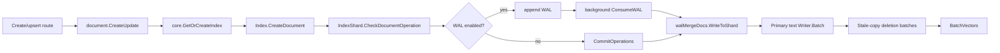

# Request Flows

> **Purpose:** Trace major end-to-end control and data flows through routes, handlers, core runtime, and storage.
> **Last verified:** 2026-10-12
> **Verified against commit:** `f823d568efdf005582209d51df919f037ad26539`
> **Relevant source paths:** `pkg/routes/`, `pkg/handlers/`, `pkg/core/`, `pkg/uquery/`, `pkg/bluge/search/`, `cmd/zinc-proxy/`

## Common HTTP Path

Compute requests enter `pkg/routes/setup.go` `Setup`, which installs recovery, access logging, pprof, optional Prometheus, and routes; `SetRoutes` installs CORS. Protected routes use HTTP Basic authentication through `pkg/routes/middleware.go` `AuthMiddleware`; only selected registrations add `ClusterMiddleware`, not every index-scoped route (`pkg/routes/routes.go` `SetRoutes`). See [APIs](apis.md#middleware-and-authentication) for route/middleware boundaries and [Architecture](architecture.md) for process ownership.

## Index Creation

```text
route -> handlers/index.Create or CreateES
      -> CreateIndexWorker
      -> core.NewIndex
      -> settings/analyzers/mappings
      -> core.StoreIndex
      -> metadata.Index.Set + core.ZINC_INDEX_LIST.Add
```

`CreateIndexWorker` resolves the index name, checks cluster ownership and existence, and parses analyzers/mappings. `core.NewIndex` applies templates before explicit settings/mappings and creates initial shard metadata (`pkg/handlers/index/create.go` `CreateIndexWorker`; `pkg/core/newindex.go` `NewIndex`, `StoreIndex`).

Mapping updates use `pkg/handlers/index/mapping.go` `SetMapping` and `core.Index.SetMappings`. Vector properties create `meta.VecIndex` metadata with an initial growing segment (`pkg/core/index.go` `SetMappings`).

## Document Write



`CreateUpdate` takes a raw document; body `_id` overrides the path ID, otherwise an ID is generated. A supplied ID requests replacement/upsert: `Index.CreateDocument` locates the existing second shard, falling back to insertion when absent. ES `_create` uses this same handler and is not create-exclusive (`pkg/handlers/document/create_update.go` `CreateUpdate`; `pkg/routes/routes.go` `SetRoutes`; `pkg/core/index_document.go` `CreateDocument`).

`document.Update` is separate: it takes the supplied document body and optional `?insert=true`, then calls `Index.UpdateDocument`, which rejects a missing document unless insertion is enabled. It does not merge the old source or unpack an ES `{doc: ...}` patch envelope; existing documents are replaced through the same operation builder (`pkg/handlers/document/update.go` `Update`; `pkg/core/index_document.go` `UpdateDocument`; `pkg/core/index_shards_document.go` `CheckDocumentOperation`).

`CheckDocumentOperation` flattens JSON, infers/validates mappings, validates vectors, and builds the internal operation. Mapping changes may be persisted before the document append/commit succeeds (`pkg/core/index_shards_document.go` `CheckDocumentOperation`).

`walMergeDocs.WriteToShard` merges repeated actions and writes the primary text batch, then stale-copy deletion batches, then `BatchVectors`, in order, not transactionally. Later failures can leave earlier mutations applied; rollback does not restore text updates/deletes or undo vectors (`pkg/core/index_shards_wal.go` `WriteToShard`, `WriteToShardRollback`, `BatchVectors`). Vector fields are stored separately from the text document; create/upsert paths require canonical base62 integer IDs for vector-enabled indexes (`pkg/core/index_document.go` `CreateDocument`, `CreateDocuments`).

With WAL enabled, success acknowledges append, not completed indexing; without WAL, the handler waits for direct batches but metadata updates are queued (`pkg/core/index_document.go` `CreateDocument`, `CommitOperations`). [WAL and Redo](data-storage.md#wal-and-redo) owns synchronization, recovery, and visibility limitations.

## Bulk Write

| Format | Compute path and worker | Proxy path |
|---|---|---|
| Document-only NDJSON | `/api/:target/_multi` -> `multi_create.go` `MultiWorker` | Owner-forwarded |
| Action/data NDJSON (delete has no data line) | Native/ES `_bulk` -> `bulk.go` `BulkWorker` | `cmd/zinc-proxy/bulk.go` `Bulk`/`EsBulk`, owner-grouped fanout |
| JSON `{index, records}` | Native `_bulkv2` -> `bulkv2_create.go` `Bulkv2Worker`; `pkg/meta/json.go` `JSONIngest` | `bulk.go` `BulkV2`, resolves path/body index and forwards to one owner |

Handler paths in the table are under `pkg/handlers/document/`; registrations are in compute `SetRoutes` and proxy `SetupHttp`. NDJSON scanners use `MaxDocumentSize` per line and skip malformed JSON lines. With WAL enabled workers append per-document operations. With WAL disabled, `BulkWorker` applies grouped deletes **before** grouped creates/upserts, not original mixed-action order; core batches commit first shards with bounded concurrency (`pkg/handlers/document/bulk.go` `BulkWorker`; `pkg/core/index_document.go` `CreateDocuments`, `DeleteDocuments`). Bulk `create`/`update` labels still use `CreateDocument`, not exclusive-create or partial-update semantics.

No bulk path is atomic across items, shards, or destinations: earlier appends/commits can survive later failures. Proxy transport/status failure fails the aggregate without rollback or alternate-owner retry. HTTP 200 ES bodies may contain item/top-level errors; proxy `EsBulk` concatenates items but does not propagate destination `Error`/`Errors` or restore input item order. Do not treat counts/status placeholders as transactional success (`pkg/handlers/document/bulk.go` `ESBulk`, `BulkWorker`, `NewBulkResponseItem`; `cmd/zinc-proxy/bulk.go` `processBody`, `Bulk`, `EsBulk`; `cmd/zinc-proxy/utils.go` `fetchHTTP`).

## Text Search

```text
native SearchV1 or ES SearchDSL
  -> V1 conversion or searchIndex
  -> Index.Search / core.MultiSearch
  -> uquery.NormalizeQuery + ParseQueryDSL
  -> time-range shard pruning
  -> SimpleSearcher lazy Bluge readers
  -> bluge/search.MultiZincSearch
  -> merge hits and aggregations; fields/highlights/source
```

Native V1 requests are converted by `pkg/uquery/query_dsl_from_v1.go` `ParseQueryDSLFromV1`. ES DSL requests use `pkg/handlers/search/search_v2.go` `SearchDSL`, with `core.MultiSearch` for multiple/wildcard indexes (`pkg/handlers/search/search_v1.go` `SearchV1`; `pkg/handlers/search/search_v2.go` `searchIndex`).

`Index.SearchWithStats` normalizes and compiles the query, extracts time range, selects relevant second shards, and calls `MultiZincSearch`. Multi-reader execution searches concurrently and heap-merges globally ordered hits and aggregation buckets (`pkg/core/search.go` `SearchWithStats`; `pkg/core/multi_search.go` `MultiSearch`; `pkg/bluge/search/search.go` `MultiZincSearch`).

## Distributed Text Search

Proxy ES `SearchDSL` and `/api/unified_search` **always** use `processUnifiedSearch`, not an ordinary owner-search fallback. Each selected destination receives `/api/internal/unified_search`, including small, single-owner indexes. `calcNodeIndexMap` gives ineligible indexes an empty second-shard list (search the whole index on its owner); eligible one-first-shard indexes are distributed round-robin up to `SS_PARALLEL_QUERY_NODE_LIMIT`. Only when more than one destination participates does the proxy first call `/api/internal/get_stats`; otherwise the internal handler gathers local statistics (`cmd/zinc-proxy/search.go` `SearchDSL`; `cmd/zinc-proxy/parallel_query.go` `UnifiedSearch`, `processUnifiedSearch`, `calcNodeIndexMap`; `pkg/handlers/search/search_v2.go` `InternalUnifiedSearch`).

Both compute `InternalUnifiedSearch` and proxy `execParallelQueries` construct a new response containing summed `hits.total.value`, maximum score, concatenated hits, and the last lock-winning response's `Took`. Both sort descending by score and truncate to a selected query's size, overriding requested field-sort order; neither preserves aggregations or all response metadata, even with one index/node. Proxy ES search rejects multi-index aggregations, but single-index aggregations are still lost in these merge layers. Ordinary compute `MultiZincSearch` aggregation merging described above is a different boundary (`pkg/handlers/search/search_v2.go` `InternalUnifiedSearch`, `UnifiedSearch`; `cmd/zinc-proxy/parallel_query.go` `execParallelQueries`; `cmd/zinc-proxy/search.go` `SearchDSL`).

Statistics use one representative query and the first encountered mappings/analyzers. Comparable scores assume the same scoring query across indexes (non-scoring filters may differ) and compatible mappings/analyzers, not arbitrary per-index queries. `UnifiedSearcher` substitutes shared term/collection statistics and falls back locally for missing terms/fields (`pkg/core/multi_search.go` `QueryStatsInfoWithSecondShardIds`, `PartialSearch`; `pkg/core/searcher.go` `unifiedReader`; `pkg/handlers/search/search_v2.go` `InternalUnifiedSearch`; proxy `processUnifiedSearch`).

Native proxy `/api/:target/_search` instead forwards directly to the owner. Proxy ES `_msearch` parses header/query NDJSON, groups exact index names by owner, forwards ordinary `_msearch`, and orders returned responses; it does not use the unified statistics/shard pipeline or merge a multi-index item into one global result (`cmd/zinc-proxy/http.go` `SetupHttp`, `directForwarding`; `cmd/zinc-proxy/search.go` `MultiSearch`). See [API target handling](apis.md#target-resolution).

## Vector Search

`pkg/handlers/search/search_vector.go` `SearchVector` validates mappings and dimensions, then calls `core.VectorSearch`. Owner/local search optionally obtains filter IDs through a text query sorted by `_id` and capped at `config.Global.MaxResults`, then searches only those IDs: it is not an exhaustive filter beyond that cap. Distances are merged; Bluge IDs queries retrieve documents and apply `_source`/`return_fields`; score is `1 / (1 + distance)` (`pkg/core/vector_search.go` `VectorSearch`, `searchVector`, `retrieveVectorDocuments`).

The proxy distributes IVFPQ when configured nodes exist and segment count reaches the parallel threshold (even if the node limit yields one destination). It sends `InternalVectorQuery` to `/api/internal/vector_search`, merges ID/distance maps, then uses internal unified text search for IDs retrieval and score ordering. This branch drops `filter_query`, `_source`, and `return_fields`: the internal vector request has none, and the new IDs query does not copy them. Ineligible IVFPQ, flat, and HNSW requests forward the reserialized full `VectorQuery` to the owner, preserving those options (`cmd/zinc-proxy/vector.go` `SearchVector`, `calcNodeSegmentsMap`; `pkg/core/vector_search.go` `InternalVectorQuery`, `InternalVectorSearch`). See [Vector Storage](data-storage.md#vector-storage) for precision/ANN limits.

## Assignment Change

The manager rewrites changed prefix assignments. Compute `pkg/cluster/cluster.go` `updateAssigns` replaces its ownership map and notifies `core.watchIndexUpdate`. That loop closes/removes unassigned runtime indexes, scans metadata, and loads newly assigned indexes (`pkg/core/indexlist.go` `watchIndexUpdate`, `updateIndexList`; `pkg/core/loadindexes.go` `LoadZincIndexFromMetadata`).

This is not a transactional handoff: there is no request-drain acknowledgment, ownership epoch, storage fencing, or replica promotion in these flows. Vector runtime cache lifetime is separate from `ZINC_INDEX_LIST`; closing/unassigning a text index is not proof of vector-cache invalidation. [Operations](operations.md) owns assignment/failover details; [Processes](processes.md) owns watcher/startup sequencing (`pkg/core/indexlist.go` `updateIndexList`; `pkg/core/vec_index_manager.go` `GetVectorIndex`, `execGC`; `cmd/cluster-manager/manager.go`).
